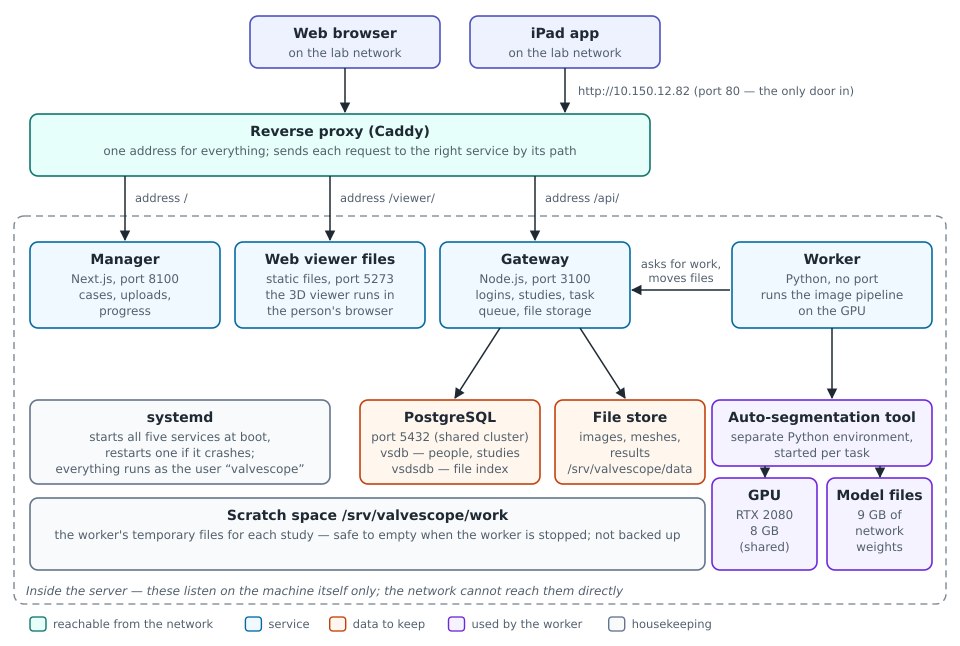
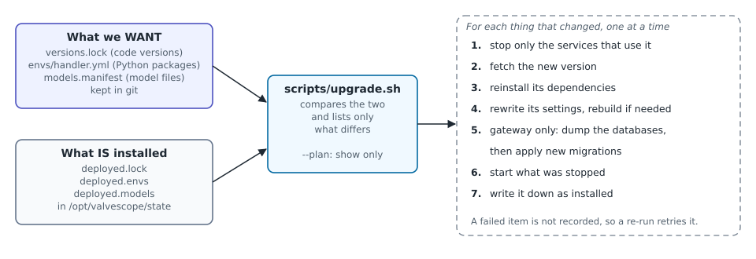
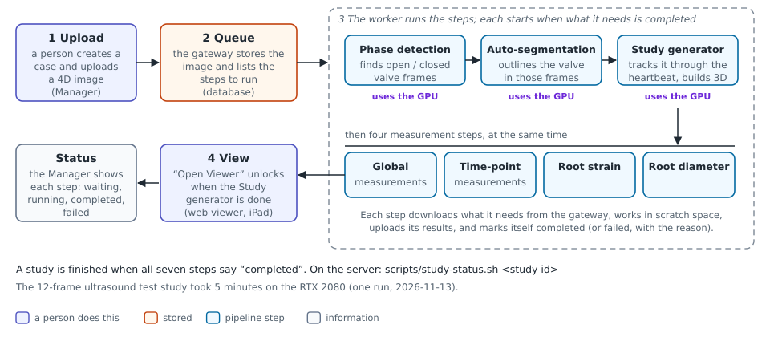
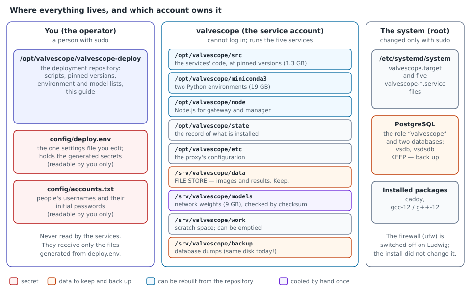
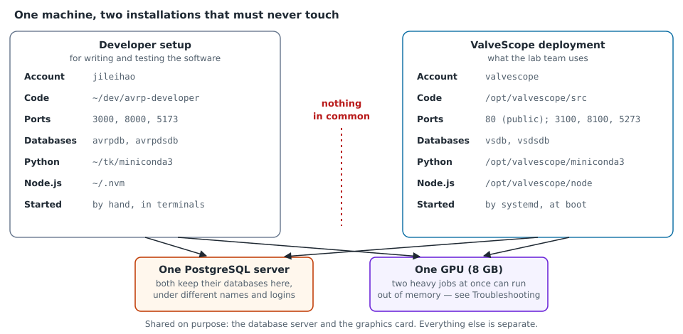

# ValveScope Server Guide

**Deploying, maintaining and understanding the ValveScope installation on the lab server**

| | |
|---|---|
| Describes | the installation on **Ludwig** (`10.150.12.82`, Ubuntu 24.04, one RTX 2080) |
| Matches | `valvescope-deploy`, branch `install/ludwig`, as installed on 2026-11-13 |
| Last updated | 2026-11-13 |
| Source | `docs/guide/ValveScope-Server-Guide.md` — edit that file, then run `docs/guide/build.sh` to remake the PDF |

## How to read this guide

This guide is for a software developer who has not run servers for a living. It
has three parts, and you can read them in any order:

- **Part 1 — Deploying.** How to put ValveScope on a server, step by step, and
  what each step does.
- **Part 2 — Maintaining.** Day-to-day checks, people's accounts, backups and
  restore, upgrades, configuration changes, removing the system, and what to do
  when something breaks.
- **Part 3 — Architecture.** What the pieces are, how a request and a study
  travel through them, where things live on disk, and why it is built this way.

If you are new to the system, skim the one-page overview below and then Part 3.

**How sure are we?** The system is young. Every procedure in this guide carries
one of three marks, so you know how much to trust it:

| Mark | Meaning |
|---|---|
| **[done on Ludwig]** | This exact procedure has been carried out on the lab server and worked. |
| **[rehearsed]** | The important part was tried safely (for example, restoring a backup into a spare database), but not the whole thing for real. |
| **[written, not tried]** | Worked out from how the system is built. Follow it with care and correct this guide afterwards. |

**Typing commands.** Commands are run on the server, in a terminal, from the
deployment folder unless stated otherwise:

```bash
cd /opt/valvescope/valvescope-deploy
```

A line that starts with `sudo` asks for administrator rights; you need to be a
person who is allowed to use `sudo` on the server.

## The system on one page

ValveScope turns a 4D heart scan (ultrasound or CT) into a moving 3D model of the
aortic valve with measurements, so a surgeon can plan a valve repair. People use
it through a web browser or the iPad app. Everything they touch is served from
one address: `http://10.150.12.82/`.



Five programs run on the server all the time. In this guide they are called
**services**:

| Service | What it does | You notice it is down when… |
|---|---|---|
| **Reverse proxy** | The front door. Receives every request and passes it to the right service. | nothing loads at all |
| **Manager** | The website for creating cases, uploading scans and watching progress. | the main page does not load |
| **Web viewer** | Hands the 3D viewer to the browser. The viewer then runs in the browser. | "Open Viewer" gives an error page |
| **Gateway** | The brain. Checks logins, keeps the list of studies, stores files, hands out work. | you cannot log in |
| **Worker** | Does the heavy image processing on the graphics card (GPU). | studies stay "waiting" forever |

Two things hold the data that matters: a **PostgreSQL database** (who the people
are, which studies exist, what state they are in) and a **file store** on disk
(the scans and the results). Lose either and the studies are gone; lose anything
else and it can be rebuilt.

**A few words used throughout**

| Word | Meaning here |
|---|---|
| **Operator** | You: the person with `sudo` who looks after the server. |
| **`valvescope` (the service account)** | A user account on the server that no person logs in to. The five services run as it, so they can only touch their own files. |
| **Deployment folder** | `/opt/valvescope/valvescope-deploy`: a copy of the `valvescope-deploy` git repository. All scripts in this guide live there. |
| **`deploy.env`** | `config/deploy.env` in that folder. The one settings file you edit by hand. |
| **Pin** | An exact version of a piece of code, written down as a git commit id. |
| **Study** | One uploaded scan and everything computed from it. |
| **systemd** | The part of Linux that starts programs at boot and restarts them if they crash. |

---

# Part 1 — Deploying ValveScope

There is one command that does the whole deployment, `install/install.sh`. This
part first gives the short route, then walks through what the installer does so
you can follow it, check it, or do a step by hand when something goes wrong.

The installer is safe to run again at any time. Each step looks at what is
already there and changes only what is missing or different. On a working
installation it changes nothing. **[done on Ludwig]**

## 1.1 What you need before you start

| You need | How to check | If it is missing |
|---|---|---|
| Ubuntu 24.04 | `lsb_release -d` | Other versions are untested. |
| A working NVIDIA graphics card with about 8 GB of memory | `nvidia-smi` shows the card | If it says *"Driver/library version mismatch"*, a driver update is waiting for a reboot. |
| PostgreSQL 16, running | `pg_lsclusters` shows a cluster as `online` | Install and start PostgreSQL first. |
| Administrator rights | `sudo -v` succeeds | Ask whoever manages the server. |
| Access to the private GitHub repositories, saved on your account | `git ls-remote https://github.com/jilei-hao/avrp-gateway.git` prints lines without asking for a password | Log in to GitHub with git once and let it remember you (`git config --global credential.helper store`, then any `git clone` of a private repository). |
| The Caddy web server | `caddy version` | See below. |
| The C++ compiler version 12 | `g++-12 --version` | See below. |
| About 45 GB of free disk | `df -h /opt /srv` | The Python environments take 19 GB, the models 9 GB. |
| The model files | you know where the three model folders are | They are not in git. Ask the person who trained them. |

Install the two missing programs, and switch off the demo website that Ubuntu's
Caddy package starts by itself (it would occupy the address ValveScope needs):

```bash
sudo apt install caddy gcc-12 g++-12
sudo systemctl disable --now caddy.service
```

**You do not need to install** Node.js or Python/conda. The installer downloads
its own copies into `/opt/valvescope`, so the deployment never depends on a
developer's personal setup. (On Ludwig the system's `node` command points into a
developer's home folder, which other accounts may not enter. That is exactly the
trap this avoids.)

## 1.2 The short route

```bash
# 1. Put the deployment folder where the service account will be able to read it.
#    A home directory will NOT work: other accounts cannot look inside it.
sudo install -d -o "$USER" /opt/valvescope/valvescope-deploy
git clone -b install/ludwig https://github.com/jilei-hao/valvescope-deploy \
    /opt/valvescope/valvescope-deploy
cd /opt/valvescope/valvescope-deploy

# 2. Create the settings file and edit it (section 1.3).
cp config/deploy.env.example config/deploy.env
nano config/deploy.env

# 3. List the people who get an account, one username per line (lower case).
nano config/accounts.txt

# 4. Check that the server is ready. This changes nothing.
install/install.sh --check

# 5. Install. It stops at step 6 and asks you to copy the model files (section 1.4).
install/install.sh

# 6. After copying the models, continue from step 6.
install/install.sh --from 6
```

The first full run took about 20 minutes on Ludwig, most of it downloading and
building the Python environments; allow longer on a slow connection. When it ends with `health: all checks passed`,
open `http://<server address>/` in a browser on the lab network.

## 1.3 The settings file

`config/deploy.env` is a list of `NAME=value` lines. Most defaults are right for
Ludwig. The ones to look at:

| Setting | What it is | On Ludwig |
|---|---|---|
| `VS_HOST` | The address people type in their browser. Never `localhost`. | `10.150.12.82` |
| `VS_LAN_CIDR` | The lab network's address range, used only if a firewall rule is needed. | `10.150.12.0/23` |
| `VS_BACKUP_DIR` | Where database backups are written. Should be a different disk. | `/srv/valvescope/backup` (same disk — see 2.4) |
| `VS_CA_BUNDLE` | The list of trusted certificates for downloads. Needed on the hospital network, which inspects encrypted traffic. | `/etc/ssl/certs/ca-certificates.crt` |
| `VS_MODULE_LIST` | The processing steps the worker runs. | all seven |
| `VS_STUDYGEN_ROI_CROP_PADDING` | Keeps the graphics card from running out of memory on CT scans. | `16` |
| Lines with `CHANGE_ME` | Passwords and keys. **Leave them.** The installer generates them. | generated |

Two rules protect the developer's own setup on the same machine: the settings
must not use ports 3000, 8000 or 5173, nor the database names `avrpdb` or
`avrpdsdb`. The installer refuses to continue if they do.

## 1.4 What the installer does, step by step

Each step below says what happens, why, and how to check it. To start again from
a particular step after fixing a problem: `install/install.sh --from <number>`.

All eleven steps were carried out on Ludwig on 2026-11-13. **[done on Ludwig]**

### Step 1 — Check the server and the settings

Nothing is changed. The installer checks everything in section 1.1, reads
`deploy.env`, and confirms that the four ports it needs (80, 3100, 8100, 5273)
are free. Run only this step with `install/install.sh --check`.

### Step 2 — Create the service account and the folders

```bash
sudo useradd --system --user-group --home-dir /opt/valvescope \
     --no-create-home --shell /usr/sbin/nologin valvescope
```

A *system* account with no password and no login shell: nobody can sign in as
it, but programs can run as it. Then the folders are created and given to that
account: `/opt/valvescope` for code and tools, `/srv/valvescope` for data.
Folders that already exist keep their contents.

*Check:* `id valvescope` prints a line; `ls -ld /srv/valvescope/data` shows
owner `valvescope`.

### Step 3 — Generate the secrets

`install/gen-secrets.sh` replaces each `CHANGE_ME` in `deploy.env` with a random
value: the database password, the key that signs logins, and the worker's own
password. Values already set are left alone, so running it again is harmless.
The file is readable only by you.

### Step 4 — Install private copies of conda and Node.js

Two downloads, each checked against a known fingerprint (checksum) before it is
used:

- **Miniconda** into `/opt/valvescope/miniconda3` — manages the Python
  environments.
- **Node.js 24.10** into `/opt/valvescope/node` — runs the gateway and the
  manager, and builds the two websites.

*Check:* `sudo -u valvescope /opt/valvescope/node/bin/node --version`.

### Step 5 — Install the service definitions and settings

The installer turns `deploy.env` into the files each service reads (this is
called *rendering*), and installs six small files in `/etc/systemd/system`: one
per service plus `valvescope.target`, which groups them. It then *enables* them,
meaning they will start by themselves when the server boots. Nothing is started
yet.

*Check:* `systemctl is-enabled valvescope.target` prints `enabled`.

### Step 6 — Check the model files (you copy them)

The trained models are about 9 GB and are not in git. A person copies them once.
The installer stops here until they are in place.

```bash
# Replace <source> with where the model folders are.
sudo cp -a <source>/ct-model/models/Dataset900_LOOCV_f0 \
           /srv/valvescope/models/ct-model/models/
sudo cp -a <source>/tee-model/models/Dataset2222_FinalAVData \
           <source>/tee-model/models/Dataset3333_FinalAVData_2Chan \
           /srv/valvescope/models/tee-model/models/
sudo chown -R valvescope:valvescope /srv/valvescope/models

scripts/verify-models.sh --full     # reads every file and compares fingerprints
install/install.sh --from 6
```

The deployment keeps a list of every model file with its size and fingerprint
(`models.manifest` and `models/*.files`). `verify-models.sh --full` proves the
copy is exact; it takes under a minute.

### Step 7 — Install the gateway and create the databases

This step and step 9 are done by `scripts/upgrade.sh` — the same script used for
every later update, so there is one way of installing code, not two. For the
gateway it:

1. downloads the gateway's code at its pinned version into `/opt/valvescope/src`
   (your saved GitHub login is lent to the service account for the length of the
   download; nothing is stored for it);
2. installs its Node.js packages (`npm ci`);
3. writes its settings file;
4. runs `install/db-init.sh`, which creates the database login `valvescope`, the
   two databases `vsdb` and `vsdsdb`, their tables, and the starting reference
   data.

`db-init.sh` only ever *adds*. It never deletes a table or a row, and it refuses
to touch a database it did not create.

*Check:* `install/db-init.sh --plan` says *"nothing to do"*.

### Step 8 — Create the accounts

`install/accounts.sh` creates the worker's own login and one login for each name
in `config/accounts.txt`. For every person without a password in that file it
makes one up and writes it into the file, next to the name, for you to hand
over. Existing accounts are never changed.

*Check:* `install/accounts.sh --list`.

### Step 9 — Install everything else

The long step. In order:

1. **The worker's Python environment** is built from `envs/handler.yml`, a list
   of 163 packages with exact versions (including the GPU build of
   PyTorch). About 10 GB.
2. **FireANTs**, the image-registration library, is downloaded and its GPU code
   is *compiled on the server* — this is what needs `g++-12`.
3. **segflow4d** and the **worker** are installed into that environment.
4. **The auto-segmentation tool** gets its own, second Python environment (it
   needs a different Python version).
5. **The manager and the web viewer** are downloaded and built. Their settings
   are baked into the built files at this moment.
6. **The models** are verified in full once more and written down as installed.

The installer records each finished item in `/opt/valvescope/state`. If the step
fails half-way (a download times out, for example), fix the cause and run
`install/install.sh --from 9`: finished items are skipped.

### Step 10 — Firewall

The installer looks at the firewall (`ufw`) and prints the one rule ValveScope
needs. It does **not** change the firewall unless you add `--apply-firewall`,
because the firewall is shared with everything else on the machine.

On Ludwig the firewall is switched off, so there was nothing to do. See 3.5 for
what that means.

### Step 11 — Start and check

```bash
sudo systemctl start valvescope.target
scripts/health.sh
```

`health.sh` runs 26 checks and ends with `health: all checks passed`. It is the
single best answer to "is it working?" — see 2.1.

## 1.5 Prove it works

Do this once after any installation. **[done on Ludwig]**

1. From another computer on the lab network, open `http://10.150.12.82/` and log
   in with one of the accounts. *(On Ludwig this was only done from a browser on
   the server itself. A check from a second machine and from the iPad is still
   owed.)*
2. Submit a test study. From the server:

    ```bash
    export GATEWAY_USER_NAME=<your account>
    read -rs GATEWAY_USER_PASSWORD && export GATEWAY_USER_PASSWORD
    /opt/valvescope/node/bin/node \
        /opt/valvescope/src/avrp-util/deployment/stage-study.mjs \
        --gateway http://10.150.12.82/api \
        --image <path to a de-identified 4D image .nii.gz> \
        --case-name test --study-name first-check --fusion-type None
    ```

    It prints the new study's number.
3. Watch it: `scripts/study-status.sh <study number>`. Every line should reach
   `completed`. The 12-frame ultrasound test study took 5 minutes.
4. In the manager, select the study and press **Open Viewer**. Log in to the
   viewer and load the study; the 3D valve and its measurements appear.

---

# Part 2 — Maintaining the system

## 2.1 Everyday commands

| I want to… | Command |
|---|---|
| know if everything is working | `scripts/health.sh` |
| see the five services | `systemctl status 'valvescope-*'` |
| stop everything | `sudo systemctl stop valvescope.target` |
| start everything | `sudo systemctl start valvescope.target` |
| restart one service | `sudo systemctl restart valvescope-gateway` (or `-handler`, `-manager`, `-viewer`, `-proxy`) |
| read a service's log, live | `sudo journalctl -u valvescope-handler -f` |
| read the last hour of a log | `sudo journalctl -u valvescope-gateway --since "1 hour ago"` |
| see how a study is doing | `scripts/study-status.sh <study number>` |
| see what versions are installed | `cat /opt/valvescope/state/deployed.lock` |
| see what is using the graphics card | `nvidia-smi` |

Stopping ValveScope leaves PostgreSQL running, because the developer setup on
the same machine uses it too.

**Reading `health.sh`.** Every line starts with `ok`, `warn` or `FAIL`. It checks
that the five services are running; that each answers; that the gateway can only
be reached through the front door; that both databases accept the login; that the
worker's account can log in; that file storage answers; that the data folders
have the right owner and at least 20 GB free; that the graphics card is visible
and no crashed job is still holding its memory; and that the model files and the
list of processing steps are as expected. It only looks; it never changes
anything. **[done on Ludwig]**

**After a reboot** the services should start by themselves (they are *enabled*).
This has **not** been tested with a real reboot yet. After the first one, run
`scripts/health.sh`.

## 2.2 People's accounts

Accounts are stored in the gateway's database. One script manages them:

| Task | How | Status |
|---|---|---|
| **Add a person** | Add their username (lower-case letters, digits, `.`, `_`, `-`) on a new line in `config/accounts.txt`, then run `install/accounts.sh`. It prints nothing secret; the generated password appears in the file next to the name. Hand it over in person. | **[done on Ludwig]** |
| **List accounts** | `install/accounts.sh --list` | **[done on Ludwig]** |
| **Reset a forgotten password** | `install/accounts.sh --reset-password <username>` — prints a new password once and updates `config/accounts.txt`. | **[done on Ludwig]** on a test account |
| **Remove a person** | No script yet. See below. | **[rehearsed]** on a test account with no cases |

Things to know:

- **People cannot change their own password.** The software has no such screen
  yet. A reset by the operator is the only way.
- **People see only their own cases.** There is no sharing between accounts yet.
- **The worker has its own account** (`vsworker`). It is not a person. Its
  password lives in `deploy.env`.
- **Usernames must be lower case.** The viewer's login box turns what is typed
  into lower case.
- **Known weakness:** the gateway will create an account for anyone who asks it
  directly, without approval. Anyone on the lab network who knows how could make
  themselves an account. It is on the list to fix in the gateway.

**Removing a person.** An account that owns cases cannot simply be deleted: the
database refuses, because the cases point to it. Decide first what should happen
to those cases (there is no tool for moving or deleting them yet). For someone
who never created a case:

```bash
# Shows the person's cases. If this prints any rows, stop and decide what to do with them.
sudo -u postgres psql -d vsdb -c "select c.case_id, c.case_name from surgery_case c
  join user_case_connection u using (case_id) join users p using (user_id)
  where p.username = '<username>'"

# Only if the list above is empty:
sudo -u postgres psql -d vsdb -c "delete from users where username = '<username>'"
```

Then remove their line from `config/accounts.txt`.

## 2.3 Changing a setting

All settings come from `config/deploy.env`. Never edit a service's own settings
file; it is overwritten the next time settings are applied.

```bash
nano config/deploy.env
install/install.sh --from 5      # re-applies settings; says which files changed
```

Applying settings does not restart anything. What you must do next depends on
what you changed:

| You changed… | Then do |
|---|---|
| a worker setting (module list, crop padding, model folders) | `sudo systemctl restart valvescope-handler` |
| a gateway setting (database, upload folder) | `sudo systemctl restart valvescope-gateway` |
| `VS_HOST` or the public port | restart the proxy **and** rebuild the manager (below) — the address is baked into the built website |
| a port number | `sudo systemctl daemon-reload`, then restart the services concerned |

Rebuilding the manager after an address change: **[done on Ludwig]**

```bash
cd /opt/valvescope/src/avrp-manager
sudo -u valvescope -H env PATH=/opt/valvescope/node/bin:/usr/bin:/bin npm run build
sudo systemctl restart valvescope-manager valvescope-proxy
```

A worker restart interrupts a study that is being processed. The interrupted
step's claim runs out after 5 minutes; the gateway then queues it again, up to
three attempts.
**[written, not tried]**

Finish with `scripts/health.sh`.

## 2.4 Backup

**What must be backed up**

| What | Where it is | Why |
|---|---|---|
| Database `vsdb` | PostgreSQL | people, cases, studies, progress |
| Database `vsdsdb` | PostgreSQL | the index of stored files |
| The file store | `/srv/valvescope/data` | the scans and every result |
| `config/deploy.env` | the deployment folder | the secrets; without the same login key every stored password stops working |
| `config/accounts.txt` | the deployment folder | the record of handed-out passwords |

The two databases and the file store **belong together**: the databases say which
files exist, the file store holds them. Back them up at the same moment and
restore them together.

**What does not need backing up:** the code, the Python environments and Node.js
(rebuilt by the installer), the scratch space, and the model files if the
original copies are kept somewhere safe.

> **Warning — the current backup location is not a real backup.** On Ludwig,
> backups go to `/srv/valvescope/backup`, which is on the **same disk** as the
> data. That protects against a mistake (a bad update), not against the disk
> failing. A lab network drive is not connected to the server yet. Until it is,
> copy the backup folder to another machine by hand from time to time.

**Database backup** **[done on Ludwig]**

```bash
scripts/backup.sh --db-only
```

It writes both databases to `/srv/valvescope/backup/db/<date and time>/` and
only reads from the live system, so it is safe while people are working.

**File store backup** **[written, not tried]** — there is no script yet:

```bash
sudo systemctl stop valvescope-handler      # so no result is half-written
scripts/backup.sh --db-only
sudo rsync -a /srv/valvescope/data/ /srv/valvescope/backup/data/
sudo systemctl start valvescope-handler
sudo cp -p config/deploy.env config/accounts.txt /srv/valvescope/backup/
```

There is no automatic schedule. Run a backup before every upgrade and whenever
important studies have been added.

## 2.5 Restore

Restoring replaces what is on the server with what was in the backup.
**Everything added since the backup is lost.**

**What has been tried:** a database backup was restored into a spare, empty
database on Ludwig with the `pg_restore` command below and compared with the
live one — same accounts, studies and tables, all owned by `valvescope`. **[rehearsed]** A full restore over the live system has not been done.
**[written, not tried]**

```bash
B=/srv/valvescope/backup/db/<date and time>      # the backup to restore

# 1. Stop ValveScope and take one more backup of the current state, just in case.
scripts/backup.sh --db-only
sudo systemctl stop valvescope.target

# 2. Remove the two current databases. This script shows what it will delete first
#    and refuses any database that is not ValveScope's.
scripts/destroy-databases.sh --yes-destroy-database vsdb --yes-destroy-database vsdsdb

# 3. Create them again, empty, and load the backup.
sudo -u postgres createdb -O valvescope vsdb
sudo -u postgres createdb -O valvescope vsdsdb
sudo cat "$B/vsdb.dump"   | sudo -u postgres pg_restore -d vsdb   --role=valvescope --no-owner
sudo cat "$B/vsdsdb.dump" | sudo -u postgres pg_restore -d vsdsdb --role=valvescope --no-owner

# 4. Put the file store back as it was at that backup.
sudo rsync -a --delete /srv/valvescope/backup/data/ /srv/valvescope/data/

# 5. Start and check.
install/db-init.sh --plan          # should say "nothing to do"
sudo systemctl start valvescope.target
scripts/health.sh
```

If the server itself was lost: install ValveScope on the new machine first
(Part 1), **using the saved `deploy.env`** instead of a fresh one, then follow
the steps above.

## 2.6 Upgrading

An upgrade means moving one or more pieces to a newer version. The versions are
written in three files in the deployment folder:

| File | Lists |
|---|---|
| `versions.lock` | the exact version of each piece of code |
| `envs/handler.yml` | the exact Python packages of the worker |
| `models.manifest` | the model files and their fingerprints |



The server remembers what it has installed. An upgrade compares that with the
three files and touches **only what differs**. Changing one line in
`versions.lock` updates one piece and restarts only the service that uses it.

```bash
git pull                      # get the new versions.lock (and anything else that changed)
scripts/backup.sh --db-only   # always, before an upgrade
scripts/upgrade.sh --plan     # shows exactly what would happen; changes nothing
scripts/upgrade.sh            # does it, then runs health.sh
```

**Status.** The planning half is covered by automated tests. The doing half has
installed everything from nothing on Ludwig. **[done on Ludwig]** What has *not*
happened yet is upgrading one piece of a running system; treat the first such
upgrade as a rehearsal and watch it. **[written, not tried]**

What each kind of change involves:

| Changed | What happens | Services restarted |
|---|---|---|
| gateway | new code, packages, **database backup**, new database changes applied | gateway |
| worker, segflow4d or FireANTs | reinstalled into the worker's Python environment | worker |
| auto-segmentation tool | its Python environment updated | none; the next study uses it |
| manager | new code, rebuilt | manager |
| web viewer | new code, rebuilt | none; files are served straight from disk |
| `envs/handler.yml` | the worker's Python environment updated | worker |
| a model | you copy the files; they are verified in full | worker |

Good to know:

- **If it fails half-way,** the piece that failed is not recorded and its
  service stays stopped. Fix the cause and run `scripts/upgrade.sh` again;
  finished pieces are skipped.
- **An upgrade restarts only services that were running.** One you stopped on
  purpose stays stopped.
- **Going back.** Put the old version back in `versions.lock` and run
  `scripts/upgrade.sh`. Code goes back; **database changes do not**. If a newer
  gateway changed the database and you must undo that, the only way is restoring
  the backup taken before the upgrade (2.5), which loses everything since.
  `scripts/rollback.sh` is not written yet.
- **Adding a model, a Python environment or a processing step** each has a short
  recipe in `docs/RUNBOOK.md`, sections 5b–5d.

## 2.7 Removing ValveScope from a server

**[written, not tried]** — worked out by reversing the installation. It removes
all studies. Take a backup you can read from another machine first.

```bash
cd /opt/valvescope/valvescope-deploy

# 1. Save what you might want later, somewhere outside /opt/valvescope and /srv/valvescope.
scripts/backup.sh --db-only
sudo cp -a /srv/valvescope/backup ~/valvescope-final-backup
cp -p config/deploy.env config/accounts.txt ~/valvescope-final-backup/

# 2. Stop the services and stop them starting at boot.
sudo systemctl disable --now valvescope.target valvescope-gateway valvescope-handler \
     valvescope-manager valvescope-viewer valvescope-proxy

# 3. Remove the service definitions.
sudo rm /etc/systemd/system/valvescope.target /etc/systemd/system/valvescope-*.service
sudo systemctl daemon-reload

# 4. Remove the two databases and the database login.
#    The script lists what it will delete and refuses anything that is not ValveScope's.
scripts/destroy-databases.sh --yes-destroy-database vsdb --yes-destroy-database vsdsdb
sudo -u postgres psql -c 'drop role valvescope'

# 5. Remove the files. Read each path twice before pressing Enter.
cd ~
sudo rm -rf /srv/valvescope
sudo rm -rf /opt/valvescope

# 6. Remove the service account.
sudo userdel valvescope
```

Caddy and the compiler (`sudo apt remove caddy gcc-12 g++-12`) can stay; other
things on the machine may use them. **Nothing in these steps touches the
developer setup:** its folder, its databases (`avrpdb`, `avrpdsdb`) and its
Python environments are separate. If a command in this section mentions one of
them, something is wrong — stop.

## 2.8 When something goes wrong

Start with `scripts/health.sh`; the `FAIL` lines usually name the problem.

| What you see | Likely cause | What to do |
|---|---|---|
| Nothing loads in the browser | the proxy is down, or the server's address changed (it is assigned by the network and can change) | `systemctl status valvescope-proxy`; `ip -4 addr` to see the current address. A changed address means changing `VS_HOST` (2.3). |
| Cannot log in; the page says the server is unreachable | the gateway is down | `sudo journalctl -u valvescope-gateway -n 50` |
| A study stays on "waiting" | the worker is down or busy | `systemctl status valvescope-handler`; `nvidia-smi` |
| A study step shows "failed" | the reason is stored with it | `scripts/study-status.sh <number>` shows the message; the worker's log has the detail. The manager shows a **Reset** button next to a step to run it again. |
| A step fails with "out of memory" on the graphics card | another job is using the card (the developer setup shares it), or a crashed job left memory in use | `nvidia-smi --query-compute-apps=pid,used_memory --format=csv`. **Do not stop a process you did not start without asking its owner.** Then press Reset. |
| `nvidia-smi` says "version mismatch" | the graphics driver was updated and the server has not been rebooted since | reboot at a convenient time |
| The Python environment build fails with `CERTIFICATE_VERIFY_FAILED` | the hospital network inspects encrypted traffic | make sure `VS_CA_BUNDLE=/etc/ssl/certs/ca-certificates.crt` is in `deploy.env` |
| The disk is filling up | the worker never deletes its scratch files | stop the worker, empty `/srv/valvescope/work`, start the worker. Never empty `/srv/valvescope/data`. |
| The viewer's "Demo Login" button gives an error | that button uses a developer password that does not exist here | use the normal login fields |
| A fetch fails with "Authentication failed" | your saved GitHub login is missing or expired | repeat the check in 1.1 |
| `db-init.sh` stops with a message | it found something it considers unsafe and changed nothing | the messages are explained in `docs/RUNBOOK.md`, section 5a |

A service that crashes is restarted automatically after 5–10 seconds. If it
keeps crashing, its log says why:
`sudo journalctl -u valvescope-<name> -n 100`.

---

# Part 3 — Architecture

## 3.1 The parts and how a request travels

Look again at the diagram on the overview page. Follow one click:

1. A person's browser asks `http://10.150.12.82/` for a page.
2. The **reverse proxy** receives it. It is the only program listening to the
   network. It decides by the first part of the address:
   - `/api/…` goes to the **gateway**,
   - `/viewer/…` goes to the **web viewer** files,
   - everything else goes to the **manager**.
3. The manager's page, now running in the browser, asks `/api/login`. The
   gateway checks the password and returns a **token** — a signed pass, valid
   for 24 hours, that the browser shows with every later request.
4. Every later request (list my cases, upload a scan, download a result) goes
   the same way: browser → proxy → gateway. The gateway reads and writes the
   database and the file store.

Why one address with three paths, instead of three addresses? A browser treats
each *address and port* as a separate site and restricts one site from talking
to another. Serving everything from one address avoids that whole class of
problem, and means only one port has to be reachable.

**The services**

| Service | Program | Listens on | Started by |
|---|---|---|---|
| Reverse proxy | Caddy | port 80, all network interfaces | `valvescope-proxy` |
| Manager | Node.js (Next.js) | port 8100, this machine only | `valvescope-manager` |
| Web viewer | Caddy, serving files | port 5273, this machine only | `valvescope-viewer` |
| Gateway | Node.js (Express) | port 3100, confined to this machine | `valvescope-gateway` |
| Worker | Python | nothing; it only makes requests | `valvescope-handler` |

"This machine only" means the service accepts connections that start on the
server itself and no others. The gateway's own code would accept connections
from anywhere, so its service definition tells Linux to drop anything that does
not come from the machine itself. `health.sh` checks this every time.

**The worker never talks to the database or the file store directly.** It logs
in to the gateway like a person would, asks "is there work?", downloads what it
needs, and uploads results. That keeps one program in charge of the data.

## 3.2 How a study is processed



When a scan is uploaded, the gateway stores the file and writes a row for each
processing step into the database, most of them marked *waiting*. This table is
the **queue**: there is no separate queueing program.

The worker asks the gateway for work every 5 seconds. When a step's inputs are
ready, the worker claims it, runs it, uploads the results and marks it
*completed*; that makes the next step ready. If the worker dies in the middle,
its claim runs out after 5 minutes and the gateway puts the step back in the
queue (up to three attempts).

| Step | What it produces | Uses the GPU |
|---|---|---|
| Phase detection | which frames show the valve open and closed | yes |
| Auto-segmentation | an outline of the valve in those frames | yes |
| Study generator | the outline carried through every frame of the heartbeat; 3D surfaces | yes |
| Global, time-point, root-strain and root-diameter measurements | the numbers shown in the viewer | no |

The first two steps call the **auto-segmentation tool**, a separate program
with its own Python environment, because the neural-network software it uses
needs a different Python version from the rest. The worker starts it for each
task and waits for it to finish.

The graphics card has 8 GB of memory, and the developer setup on the same
machine uses the same card. Two heavy jobs at once can fail for lack of memory;
the failed step can simply be run again.

## 3.3 Where things live



Three owners, on purpose:

- **You, the operator,** own the deployment folder and the two files with
  secrets in them. The services never read these.
- **The service account `valvescope`** owns everything the services run from and
  write to. If a service were broken into, the damage would stop at these
  folders: the account has no password, no `sudo`, and cannot read your home
  folder or the secrets file.
- **The system** holds the service definitions and PostgreSQL. Changing these
  needs `sudo`.

A rule of thumb for what matters: **orange is data** — back it up. **Blue can be
rebuilt** by running the installer. **Purple was copied by hand once** and is
checked against its fingerprints.

**How settings reach the services.** You edit one file. A script turns it into
the six files the services actually read:

| Generated file | Read by |
|---|---|
| `/opt/valvescope/src/avrp-gateway/.env` | gateway (database login, signing key, file store location) |
| `/opt/valvescope/src/avrp-handler/.env` | worker (its login, steps to run, model locations) |
| `/opt/valvescope/src/avrp-manager/.env.production.local` | the manager's **build** |
| `/opt/valvescope/src/avrp-view-service/.env.production.local` | the viewer's **build** |
| `/opt/valvescope/etc/Caddyfile` | reverse proxy (which path goes where) |
| `/etc/systemd/system/valvescope-*.service` | systemd (what to run, as whom) |

The two marked **build** are read when the website is built, not when it runs.
That is why changing the server's address means rebuilding the manager.

## 3.4 Sharing the machine with the developer setup



Ludwig is also where the software is developed. The developer setup and the
deployment are kept apart in every way that can be: different accounts, folders,
ports, database names, Python and Node.js installations. The scripts enforce the
parts they can see — they refuse the developer's ports and database names, and
the only script able to delete a database refuses any database that is not
ValveScope's.

Two things are shared, because there is only one of each:

- **The PostgreSQL server.** Both keep their databases in it, under different
  names and with different logins. Stopping ValveScope does not stop PostgreSQL.
- **The graphics card.** See 3.2.

**For the operator this means:** never run the developer setup's "reset" or
"rebuild" scripts thinking they act on ValveScope, and never point a ValveScope
setting at a developer folder or database.

## 3.5 Security, plainly

What protects the system today, and what does not.

| Protected by | Details |
|---|---|
| The lab network | The server is reachable only from the lab network. Traffic is **not encrypted** (plain `http`), so passwords cross the lab network in the clear. |
| One front door | Only port 80 belongs to ValveScope. The other four services cannot be reached from the network. |
| Logins | Every request except logging in needs a valid token. People see only their own cases. |
| A powerless service account | Described in 3.3. |
| Secrets in one file | `deploy.env`, readable only by the operator. Passwords are generated, not chosen. |
| De-identified data only | **No scan that identifies a patient may be uploaded.** The server is not set up for identifiable patient data. |

Known gaps, so nobody assumes otherwise:

- **The firewall on Ludwig is switched off.** ValveScope's own internal services
  are safe from the network regardless, but other programs on the machine,
  including the developer setup's services, are reachable from the lab network.
  Turning the firewall on is a decision for whoever owns the machine.
- **Anyone on the lab network can create themselves an account** by talking to
  the gateway directly (2.2).
- **The worker writes its login token into its log.** The log is readable only
  with `sudo`.
- **No encryption, no password changes by users, no account lock-out.**

## 3.6 How versions are controlled

Nothing is installed "at the latest version". Every piece is pinned:

- **Code:** `versions.lock` names one exact commit for each of the nine pieces.
- **The worker's Python packages:** `envs/handler.yml` lists each with its exact
  version. Pieces installed on top are not allowed to pull in anything else, and
  a consistency check runs after each.
- **Tools:** the installer downloads one specific Miniconda and one specific
  Node.js and checks their fingerprints.
- **Models:** every file's size and fingerprint is recorded.

The point is that the same deployment folder gives the same system next month as
it does today, and that a change is always a visible edit to one of those files.

One piece is less strict: the auto-segmentation tool's environment pins its main
packages but lets their dependencies float, so a future rebuild could pick up
newer ones.

**Rules the scripts follow**

1. *Deploying never deletes data.* The installer and the upgrade script only
   add. Deleting is possible only through `scripts/destroy-databases.sh`, which
   must be told the exact database name.
2. *One piece can be upgraded alone.* (2.6)
3. *Fixes to a service are made in that service's own repository,* and then its
   pin is moved. The deployment folder contains settings and scripts, never
   patched code.

---

# Appendix

## A. Quick reference

| | |
|---|---|
| Address | `http://10.150.12.82/` (viewer at `/viewer/`) |
| Deployment folder | `/opt/valvescope/valvescope-deploy` |
| Settings | `config/deploy.env` |
| People | `config/accounts.txt`, `install/accounts.sh` |
| Is it working? | `scripts/health.sh` |
| Start / stop | `sudo systemctl start valvescope.target` · `sudo systemctl stop valvescope.target` |
| Logs | `sudo journalctl -u valvescope-gateway` (or `-handler`, `-manager`, `-viewer`, `-proxy`) |
| Backup | `scripts/backup.sh --db-only` → `/srv/valvescope/backup` |
| Upgrade | `scripts/upgrade.sh --plan`, then `scripts/upgrade.sh` |
| Data | databases `vsdb`, `vsdsdb`; files in `/srv/valvescope/data` |

## B. What is still open

Kept here so the guide does not promise more than exists. Update this list as
items are done.

| Item | State |
|---|---|
| Check from a second computer and from the iPad | not done |
| Reboot test | not done; services are set to start at boot |
| Upgrade of one piece on the running system | not done |
| Full backup script (databases + files), a schedule, and a backup location on another disk | not built; manual steps in 2.4 |
| Full restore over the live system | not done; database restore rehearsed |
| Uninstall | written, not tried |
| `scripts/rollback.sh` | not built |
| A fixed name for the server instead of a network-assigned address | not done |
| Password change by users; account removal script; sign-up approval | not built (gateway) |
| Automatic clean-up of the worker's scratch space | not built |
| Two measurements differed between two runs of the same test study (geometric height) | not investigated |
| Firewall | switched off on Ludwig; owner's decision |

## C. Keeping this guide current

1. Edit `docs/guide/ValveScope-Server-Guide.md`.
2. If a diagram must change, edit `docs/guide/img/make_diagrams.py` and run it.
3. Run `docs/guide/build.sh`. It needs only Python 3 with the `markdown-it`
   package and Google Chrome, both already on Ludwig.
4. When you carry out a procedure marked **[written, not tried]**, change its
   mark and fix whatever turned out to be wrong.
5. Commit the `.md`, the `.svg` files and the `.pdf` together.
